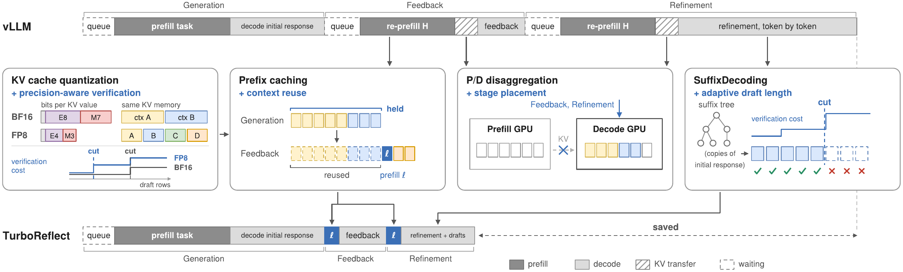

# TurboReflect: Infrastructure Optimization for Efficient Agentic Reflection

This is the repository accompanying the paper:

> **TurboReflect: Infrastructure Optimization for Efficient Agentic Reflection**
>
> Anonymous submission


## Overview

TurboReflect is a training-free, model-agnostic system that accelerates each reflection program as one unit. A reflection program runs generation, feedback and refinement stages in sequence, optionally over several rounds or with feedback and refinement merged into one stage. Later stages share almost all of their context with the stage before, and much of what they write is copied from it. TurboReflect removes this repeated work with four components:

- **Program-level context reuse**: each later stage resumes from its predecessor's KV cache in place, and prefills only what it appends.
- **Adaptive draft length**: drafts come from SuffixDecoding, and their lengths are set from verification times measured on the deployment. Drafts are only shortened, so outputs keep the model's distribution.
- **Locality-aware P/D disaggregation**: each stage favors the instance that holds its context, within a relative decode-latency budget δ.
- **KV cache quantization**: vLLM's FP8 KV cache, which keeps more contexts resident. Verification times are measured at the KV precision in use, so draft lengths suit FP8 as well.



*vLLM (top) and TurboReflect (bottom) on one reflection program. Each component extends a standard inference technique (black) with what reflection needs (blue).*

On offline batches of reflection tasks, across four models spanning latent, grouped-query and hybrid attention, TurboReflect reduces cost by up to 3.1× and decode latency by up to 5.2× relative to vLLM in its default configuration. It reduces cost by up to 2.7× even when vLLM enables its native speculative decoding, KV cache quantization and P/D disaggregation, while preserving overall task performance.


## What is in this repository

TurboReflect is built on vLLM v0.26.0. The system is in `turboreflect/`, and vLLM with its changes in `vllm/`:

- `turboreflect/__main__.py`: the command line entry point (`run`, `calibrate`, `report`).
- `turboreflect/config.py`: reads a run configuration and turns the component switches into engine settings.
- `turboreflect/program/`: reflection programs: task files, stage prompts, two-stage, three-stage and multi-round shapes, video inputs.
- `turboreflect/engine/`: runs a batch of programs on one engine, the setup without P/D.
- `turboreflect/context_reuse/`: the scheduler that holds a finished stage's KV cache for its successor.
- `turboreflect/adaptive_draft/`: per-step draft lengths from the measured step-time model.
- `turboreflect/locality_pd/`: stage placement, the δ budget, multi-engine execution and KV transfer.
- `turboreflect/calibration/`: deployment calibration of step times and P/D costs.
- `turboreflect/metrics/`: step records, run metrics and the output directory.
- `turboreflect/benchmarks/`: synthesis and automatic run scripts for RULER and LongBench-v2, and sample tasks and a format verifier for building your own benchmark.
- `turboreflect/configs/`: one configuration per model, which states that model's settings, and one for video tasks.
- `turboreflect/examples/`: a small end-to-end example and a P/D configuration.
- `vllm/`: vLLM with the scheduler hooks, verification paths and KV transfer changes TurboReflect needs; see [changes to vLLM](docs/turboreflect/vllm-changes.md).

The commit "vLLM v0.26.0" holds that release unchanged, so a diff against it shows every change.


## Setup

### 1. Create the environment

The build needs `g++` 10 or newer, which compiles `arctic-inference`, and OpenSSL 3, which NIXL links against.

```bash
# from the root of this repository
uv venv --managed-python --python 3.12
source .venv/bin/activate
uv pip install --torch-backend=cu130 --index-strategy unsafe-best-match \
    -r requirements/turboreflect/cu130.txt

# this source tree on the binaries of vLLM v0.26.0
WHEEL=vllm-0.26.0-cp38-abi3-manylinux_2_28_$(uname -m).whl
VLLM_USE_PRECOMPILED=1 \
    VLLM_PRECOMPILED_WHEEL_LOCATION=https://github.com/vllm-project/vllm/releases/download/v0.26.0/$WHEEL \
    VLLM_VERSION_OVERRIDE=0.26.0+turboreflect \
    uv pip install --no-build-isolation --no-deps -e .

# SuffixDecoding
uv pip install --constraint requirements/turboreflect/cu130.txt \
    --index-strategy unsafe-best-match arctic-inference==0.1.1
```

`cu130` needs an NVIDIA driver of 580 or newer. For CUDA 12.9 (driver 575 or newer), replace `cu130` with `cu129` and use the wheel `vllm-0.26.0+cu129-cp38-abi3-manylinux_2_28_$(uname -m).whl`.

### 2. Get a model

TurboReflect runs any model vLLM serves: a new model needs only a configuration file and deployment calibration, no code; see [adding a model](docs/turboreflect/adding-a-model.md). `model` takes a Hugging Face repo id, downloaded on first use, or a local checkpoint.

`turboreflect/configs/` has a ready file for each tested model: GLM-4.7-Flash, Qwen3-14B, Qwen3.8-27B and Kimi-K2.6. These pin attention backends for compute capability 9.x (10.x for Kimi-K2.6); on other GPUs, set `attention_backend: null`.


## Usage

### Quick start

```bash
bash turboreflect/examples/quickstart.sh
```

This needs one GPU with at least 48 GB of memory. It builds the first eight items of [LongBench-v2](https://github.com/THUDM/LongBench) as tasks for Qwen3-14B, calibrates, runs them, writes the results to `runs/quickstart/` and prints each run's makespan, cost, decode latency, prefix hit ratio and draft acceptance.

### Example

One of the quick start's tasks, `tasks/quickstart/data/longbench_670aac92bb02136c067d218a_32k.json`, with its document shortened here:

```json
{
  "id": "longbench_670aac92bb02136c067d218a_32k",
  "system": "",
  "user_task": "Please read the following text and answer the question below.\n\n<text>\n{context}\n</text>\n\nWhat is the correct answer to this question: Which floor do Becca DiNuzio and Greg Barney live on?\nChoices:\n(A) The first floor\n(B) The second floor\n(C) The third floor\n(D) There are contradictory descriptions\n\nFormat your response as follows: \"The correct answer is (insert answer here)\".",
  "context": {
    "document": "My fault, my failure, is not in the passions I have, but in my lack of control of them. —Jack Kerouac ..."
  },
  "rubric": [],
  "source": {"bench": "longbench-v2", "prompt": "0shot", "tier": "32k", "truncated": true}
}
```

`user_task` is LongBench-v2's own prompt, and the document, a detective novel middle-truncated to fit 32,000 tokens, fills its `{context}` slot. The gold answer is kept apart in `rubrics/`, which a run never reads. A three-stage program runs it as follows:

- **Generation** answers the question, ending with "The correct answer is (X)".
- **Feedback** reviews that answer against the document and asks for the most important changes.
- **Refinement** revises the answer as the review asks.

### Configure a run

Edit these lines of the model's file, for example `turboreflect/configs/qwen3-14b.yaml`; its other fields need no change:

```yaml
tasks: tasks/my_tasks             # the directory of your task files
program: three_stage              # two_stage, three_stage or multi_round

context_reuse: true               # program-level context reuse
adaptive_draft_length: true       # adaptive draft length
kv_cache_dtype: fp8               # KV cache quantization
```

Set `context_reuse` or `adaptive_draft_length` to `false`, or `kv_cache_dtype` to `bf16`, to turn that component off.

By default each stage generates exactly `gen_tokens` tokens, past the end of sequence, to measure speed. To score the outputs, add `decode_paths: [quality]`, which stops each stage at the end of sequence.

For locality-aware P/D, add a `pd` block to the file. This one runs two prefill and two decode engines, one GPU each:

```yaml
pd:
  prefill: 2                      # prefill engines
  decode: 2                       # decode engines
  delta: 1.0                      # the relative decode-latency budget δ
  max_num_seqs: 17                # programs per engine, see below
```

`max_num_seqs` is required for P/D: calibrate the file without its `pd` block first, and it prints the value. `turboreflect/examples/pd.yaml` is a complete P/D file, and every setting is in the [configuration reference](docs/turboreflect/configuration.md).

### Calibrate the deployment

Adaptive draft length and locality-aware P/D read times measured on your deployment. Calibrate once per model, GPU and configuration; `run` finds the results on its own:

```bash
python -m turboreflect calibrate --config turboreflect/configs/qwen3-14b.yaml
```

### Run

```bash
python -m turboreflect run --config turboreflect/configs/qwen3-14b.yaml --out-dir runs/my_run
```

Key arguments of `run`; `calibrate` takes the same, except `--dry-run`:

- `--config`: the run configuration.
- `--tasks`, `--model`, `--out-dir`: override these fields of the configuration.
- `--set NAME=VALUE`: override any field; a dotted name reaches into a block, as in `--set pd.delta=0.5`.
- `--dry-run`: check that every task fits `max_model_len` without starting an engine.

`python -m turboreflect report runs/my_run` prints the table again from the run directories.


## Benchmarks

Scripts for RULER and LongBench-v2 build the tasks from the original data, run them and export the answers of the generation and refinement stages in each benchmark's own format, to be scored with its own tool:

```bash
# RULER (https://github.com/NVIDIA/RULER): four tasks of 50 items each
bash turboreflect/benchmarks/run_ruler.sh turboreflect/configs/qwen3-14b.yaml ruler_assets

# LongBench-v2 (https://github.com/THUDM/LongBench): all 503 items, documents
# middle-truncated to TARGET tokens of the model's tokenizer, 32,000 by default
bash turboreflect/benchmarks/run_longbench_v2.sh turboreflect/configs/qwen3-14b.yaml [TARGET]
```

[`turboreflect/benchmarks/README.md`](turboreflect/benchmarks/README.md) shows how to fetch RULER's haystack material into `ruler_assets`, the step-by-step commands, the decoding settings and how to score.

### Build your own benchmark

Collect tasks for your own scenario and write each as one JSON file in the [task format](docs/turboreflect/task-format.md), which walks through a text task and a video task: its documents, the task, and the criteria its answer is judged against, with video clips if it has any. `turboreflect/benchmarks/custom/` gives a sample text task and a sample video task to follow, and the format verifier. Any folder of tasks that passes the verifier runs as a benchmark; run it with `decode_paths: [quality]`:

```bash
python -m turboreflect.benchmarks.custom.verify_format my_tasks/
python -m turboreflect calibrate --config turboreflect/configs/qwen3-14b.yaml --tasks my_tasks
python -m turboreflect run --config turboreflect/configs/qwen3-14b.yaml --tasks my_tasks --out-dir runs/my_tasks
```

Score each program's `artifact` with your benchmark's own tool.


## Inputs and Outputs

### Inputs

- **Task files**: one JSON file per task, with `id`, `system`, `user_task`, `context` and `rubric`, and optional `videos`.
- **Run configuration**: the model, the components to enable and the engine settings.
- **Calibration files**: written by `calibrate` and read by adaptive draft length and locality-aware P/D.

### Outputs

- **`summary.json`**: makespan, cost, decode latency, mean program end-to-end latency, throughput, prefix hit ratio, matched prefix and append lengths, draft acceptance, KV cache usage and P/D handoff times.
- **One record per program**: each stage's numbers and its generation, feedback or refinement text.
- **Step logs**: per-step engine records, from which decode latency is computed.

Cost is reported in GPU-seconds, and in dollars per million tokens when a GPU-hour price is set with `gpu_hour_usd`. A run writes these into a directory of its own under `--out-dir`, described in [the run directory](docs/turboreflect/run-directory.md).


## Notes on the Current Implementation

- TurboReflect targets offline batches of reflection programs.
- Locality-aware P/D uses NIXL for KV transfer and runs its engines on one node.
- Video tasks run on models with a video encoder; see `turboreflect/configs/`.


## Acknowledgements

This work builds on:

- [vLLM](https://github.com/vllm-project/vllm): the inference engine TurboReflect extends.
- [SuffixDecoding](https://github.com/snowflakedb/ArcticInference): the draft method used by adaptive draft length.
- [NIXL](https://github.com/ai-dynamo/nixl): KV transfer between instances.
- [FlashInfer](https://github.com/flashinfer-ai/flashinfer): attention kernels.
- [RULER](https://github.com/NVIDIA/RULER) and [LongBench](https://github.com/THUDM/LongBench): the public benchmarks with scripts in this repository.


## License

Apache-2.0, as vLLM. [THIRD_PARTY_NOTICES.md](THIRD_PARTY_NOTICES.md) lists the code adapted from RULER and LongBench, with their licenses.
